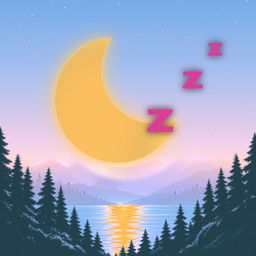
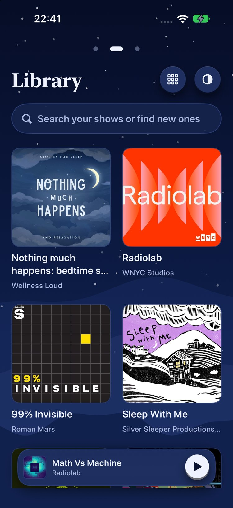
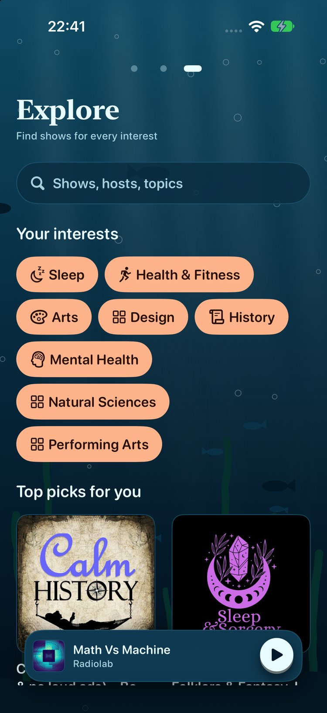
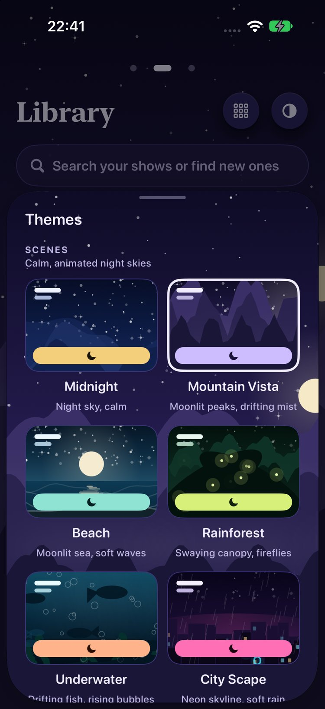
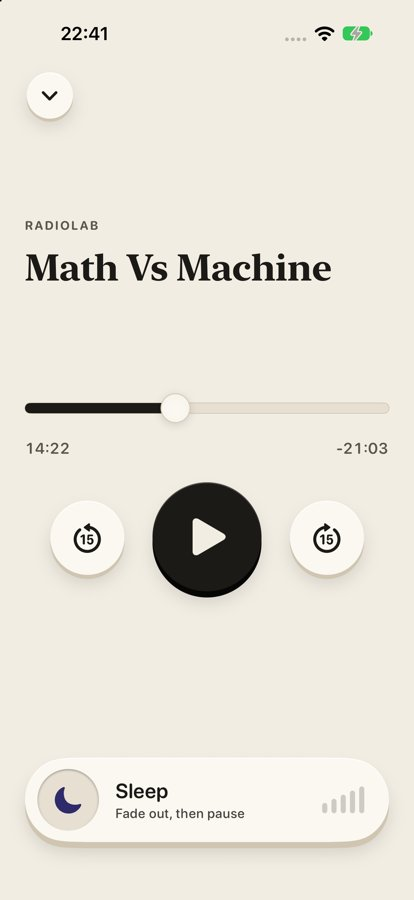
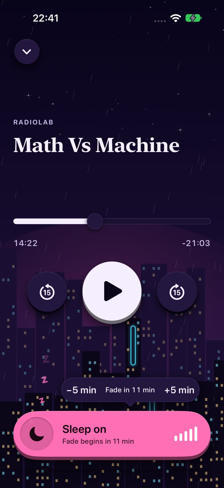
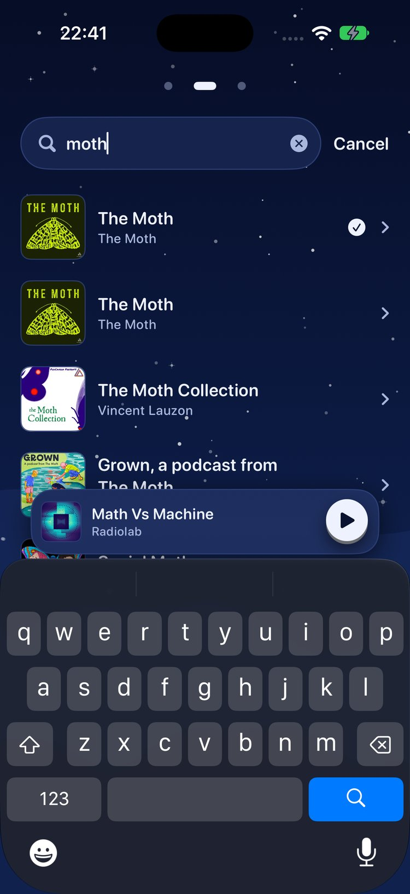

<p align="center">
  <picture>
    <source media="(prefers-color-scheme: dark)" srcset="docs/icon-dark.png">
    
  </picture>
</p>

# YawnCast

A calm iPhone podcast app for falling asleep. Tap the moon and drift off: your episode fades out gently and pauses.

> "YawnCast" is a working name. It has not been trademark-cleared.

## Screenshots

| Library (Midnight) | Explore (Underwater) | Themes |
|---|---|---|
|  |  |  |

| Now Playing, light (Paper) | Now Playing, dark (City Scape, Sleep on) | Search |
|---|---|---|
|  |  |  |

Shows in the screenshots are public podcasts from Apple's directory, mostly from the `-demo` launch argument. No accounts are involved.

## What it does

- **Three home pages** you swipe between: **New** (latest episodes from your shows), **Library** and **Explore**.
- **One search bar** on Library that filters your shows and finds new ones, right in place.
- **Sleep:** one tap on the Moon starts a countdown, then the volume steps down 10% every 40 seconds and the episode pauses. A small bubble nudges the fade by 5 minutes either way.
- **Show pages** list every episode under year headings, newest or oldest first.
- **A mini player** that stays on every screen; swipe down to close Now Playing.
- **Ten themes:** six animated Scenes (Midnight, Mountain Vista, Beach, Rainforest, Underwater, City Scape) and four Color Scapes (Paper, Ember, Ink, Red Light).
- **No account, no backend.** Search goes to Apple's public iTunes Search API, and feeds come straight from publishers.

## Dark mode

YawnCast is dark by default, because it's meant for bedtime. You pick a theme from the Themes sheet (the half-filled circle in the Library header), and each theme sets the app's appearance:

- **Paper** is the light theme.
- **Midnight** (default), the other Scenes, **Ink**, **Ember** and **Red Light** are dark. Red Light keeps blue out of the interface entirely.

The app follows your chosen theme rather than the system setting, so it stays dark at night even if your phone is in light mode. Your choice is saved with your library. The app icon has a light and a dark version, and iOS picks the matching one for your Home Screen. All ten themes pass WCAG AA contrast (see [Design tokens and themes](#design-tokens-and-themes)).

## Install

YawnCast is not on the App Store yet. To run it, build it from source with Xcode.

Requirements: a Mac with **Xcode 27** (iOS 27 SDK). The app runs on **iOS 18.0** or later ([DECISIONS D02](DECISIONS.md)).

**On the simulator**

1. Clone the repo: `git clone https://github.com/HarrisonFischberg/YawnCast.git`
2. Open `YawnCast.xcodeproj` in Xcode.
3. Choose the **YawnCast** scheme and an iPhone simulator, then press Run.

No API keys or accounts are needed.

**On your iPhone**

1. Connect your iPhone and pick it as the run destination.
2. In the YawnCast target's **Signing & Capabilities**, choose your own team (the project ships with the owner's team, `KTV2G3Z883`) and, if needed, a unique bundle ID.
3. Press Run. The first time, trust the developer profile under **Settings → General → VPN & Device Management**.

**From the command line**

```bash
export DEVELOPER_DIR=/Applications/Xcode.app/Contents/Developer   # only if xcode-select points at the Command Line Tools
xcodebuild -project YawnCast.xcodeproj -scheme YawnCast -destination 'platform=iOS Simulator,name=iPhone 17' build
```

Status: built and tested on the iOS Simulator, and the device checks D1 to D8 below were passed on the owner's iPhone on 2026-10-17. It is **not** App Store-ready yet (see [Known limitations](#known-limitations)).

<details>
<summary>Version notes</summary>

- **Lights Out (not yet released):** every screen is cut paper over the Scenes (no glass): paper cards, tags and keys, the show's cover on Now Playing, and the ten fade steps drawn from each Scene's own world (lanterns in City Scape, fireflies in Rainforest, jellyfish Underwater, boats at the Beach, tents in Mountain Vista, stars at Midnight). The Sleep chip and the rising z's are gone; −5 and +5 sit on the Moon bar. See [DESIGN.md](DESIGN.md).
- **v0.17:** Themes is now **Scenes** (the six animated ones), **Colours** (four flat palettes with day pages that follow the phone: Almanac, Ember, Plum, Meadow, which absorb the old Color Scapes) and **Text** (Picture Book or Sign-Off lettering), chosen separately. Every theme shares the labelled New / Library / Explore tabs, outlined round keys, and a see-through Sleep bar with a ten-mark progress bar, three lines of rising z's, and an icon that follows the Scene. The ±5 bubble is now a Sleep chip.
- **v0.11:** Library has one full-width search bar that filters your shows and finds new ones.
- **v0.10:** Sleep fades over 6 minutes (10% every 40 s); smaller player that always stays on screen; swipe down to close Now Playing; Library reorders live as you drag.
- **v0.9:** smoother in-place search; the player shrinks to an oval while typing.
- **v0.8:** search happens in place on Library and Explore; category pages open cleanly with placeholder tiles.
- **v0.7:** softer, warmer Red Light; the slid-away player becomes a small oval you tap to restore.
- **v0.6:** Underwater scene and the Red Light Color Scape.
- **v0.5:** Themes sheet with animated Scenes and Color Scapes.
- **v0.4:** Midnight night-sky theme (default); Library drag to reorder and Large / Small / List layouts; Explore interests and categories.
- **v0.3:** show pages list every episode under year headings; Sleep ±5 minute bubble and floating z's.
- **v0.2:** Home is three swipeable pages: New, Library and Explore.

</details>

---

## Development

### Debug-only launch arguments
These are excluded from Release builds ([D20](DECISIONS.md)).

| Argument | Effect |
|---|---|
| `-demo` | Uses an in-memory library seeded with 6 real shows and loads a real Radiolab episode, paused |
| `-synthetic` | Like `-demo` but with eight invented shows, covers drawn in code and no network (used by `scripts/design_capture.sh`) |
| `-theme <colour id>` | Forces a colour or Scene |
| `-look picturebook\|signoff` | Forces the text style |
| `-openPlayer`, `-openShow`, `-search <term>`, `-sleepOn`, `-autoplay` | Opens screens or starts states, used for screenshots |
| `-fastSleep` | Short Sleep timings: fade after 4 s, a step every 6 s |
| `-uitest [-resetStore]` | Fixture search and feeds, a bundled test tone, and a separate library file |
| `-liveTest` | Real network with a throwaway in-memory library |

---

## Architecture

```
YawnCastCore/  (Swift package, no UIKit/AVFoundation; tested with `swift test`)
  Models/       Show, Episode, PlaybackPosition, Feed, FeedURL (canonical identity)
  Directory/    DirectoryService, ITunesDirectory (search, lookup, genre charts), Recommender
  Feed/         FeedService, HTTPFeedService, RSSParser (XMLParser; durations, dates, HTML), LatestEpisodes
  Persistence/  LibraryStore, JSONLibraryStore (atomic; moves corrupt files aside), MemoryLibraryStore
  Sleep/        SleepTimer (pure state machine), SleepController (clock, active-time meter)
  Playback/     SeekMath, TimeFormat, SleepCopy

YawnCast/      (SwiftUI app, iOS 18+, Swift 6, default MainActor isolation)
  App/          YawnCastApp, AppModel (library, feeds cache, playback, Sleep wiring)
  Playback/     PlaybackEngine (AVPlayer, audio session, interruptions, route change, gain)
                NowPlayingBridge (Lock Screen info, remote play/pause/±15/scrub)
                ArtworkCache (memory + disk; artwork never altered), FeedDiskCache
  Design/       Theme tokens, KeyStyle (physical key), MoonKey, Scrubber
  Views/        HomeView (pager, PageDots, NewEpisodesView, ExploreView), LibraryView + MiniPlayer,
                SearchView, ShowView, NowPlayingView, AppearanceSheet
  TestSupport/  Fixtures + DebugLaunch (Debug only)
YawnCastUITests/  CoreFlowUITests, SleepUITests, LiveNetworkUITests (opt-in)
```

- **Search:** Apple iTunes Search API. No credentials, and no backend ([D03](DECISIONS.md)).
- **Sleep:** a deterministic state machine that only advances on *active playback seconds*. Paused or buffering time doesn't count. The clock is injectable for tests, and no SwiftUI timer is involved.
- **Fade:** the app sets `AVPlayer.volume`, which is local to the app; it never changes the device volume.
- **Sleep and relaunch:** Sleep state is never persisted, so it can't come back on its own after a relaunch.

### Sleep behaviour (v0.3)
Let R be the playable seconds remaining when Moon is tapped.

1. **Countdown:** the fade begins after `min(30 min, R/2)` of active playback, or after 30 min if the duration is unknown. Paused or buffering time doesn't count.
2. **Adjust it:** a bubble pops up above the Moon key with **−5 min** and **+5 min**.
   - −5 can bring the fade forward to "now", never into the past.
   - +5 can push it out to at most 4 hours.
   - While fading, +5 pauses the fade: the volume glides back up, and fading starts again 5 minutes later.
3. **Fade:** the volume drops **10% every 40 seconds**: 90%, 80% … 10%, 0%, so 100% to 0% takes 6 minutes. Each step is a 2 s glide.
4. **Silence:** at 0% the episode pauses, the position is saved, Sleep ends, and the volume is restored silently. Nothing else plays.
5. **While Sleep is on,** small "z"s drift up out of the moon. With Reduce Motion they sit still.
6. **Cancelling:** a second Moon tap cancels Sleep and glides the volume back over 1 s. Playing a different episode also cancels it.
7. **Scrubbing** doesn't reset the countdown.
8. If Moon is tapped before the stream reports its real length, the feed's length is used, then corrected once ([D11](DECISIONS.md)).

---

## Design tokens and themes

All ten themes pass WCAG AA. Check with `python3 scripts/contrast.py` (reads `YawnCast/Design/Theme.swift`, flags drift from `replica/design/tokens.<theme>.json`). Full principles are in [replica/design/principles.md](replica/design/principles.md).

| Role | Midnight (default) | Paper (day) | Ink (dark) | Ember (bedtime) |
|---|---|---|---|---|
| bg | #0A1430 + night sky | #F2EDE3 | #111113 | #070504 |
| surface | #16244D | #E7E0D2 | #1C1C20 | #110C09 |
| raised | #1E2F60 | #FBF8F2 | #26262B | #1A120D |
| text | #EEF2FF | #1C1A16 | #F1EEE7 | #B98F6C |
| text-muted | #A9B7DD | #5C564B | #A29E95 | #9C7A5C |
| accent (Moon only) | #F4CF7B | #2E2A6B | #E9B44C | #C27142 |
| on-accent | #1A1408 | #F7F3EA | #1A1408 | #070504 |
| Lowest text contrast | 5.87:1 (muted on lightest wave) | 5.54:1 | 6.36:1 | 4.95:1 |

Ember's brightest text has a relative luminance of 0.31, against 0.86 for Ink.

Type uses system fonts only (SF / New York via `.serif`), mapped to Dynamic Type styles. Spacing is on a 4 pt base. Play/Pause is the only button with the primary face; the accent colour is used only for the Moon ([D12](DECISIONS.md)).

---

## Tests: commands and actual results

```bash
scripts/test.sh
```

```bash
scripts/test.sh --live
```

`scripts/test.sh` runs core tests, Debug and Release builds, and the fixture UI tests. `--live` also runs the real-network test.

Results from the last full run (2026-10-15, v0.4, iPhone 18 Pro simulator, iOS 27.0):

| Check | Result |
|---|---|
| `swift test` (YawnCastCore) | **90 tests in 16 suites passed**: Sleep timing, gain sequence, pause and buffering freeze, cancel, episode end, seek, provisional duration, RSS fixtures (including malformed), search decoding and dedupe, persistence, seek clamping, genres and charts, recommendations, New-page ordering, 10%-per-minute fade, ±5 adjustments, paged feeds, year grouping, categories and interests, Library order and layout |
| Debug and Release builds | **BUILD SUCCEEDED**, no Swift warnings. The Release bundle contains no fixtures and no debug symbols |
| Fixture UI tests | **17 executed, 0 failures**: empty library; search empty, error and retry; subscription survives relaunch; subscribe → play → Sleep on/off; position survives relaunch (no autoplay); full fade on the real player; cancel mid-fade; pause freezes the countdown; page dots and swipes; mini player on every screen; unsubscribe from Library; ±5 bubble; year sections and order toggle; hiding the mini player; tucking the bubble; drag to reorder and layouts; Explore categories |
| Live UI test (opt-in) | **Passed** (2026-10-15): real search, real RSS (524 episodes), subscribe, stream played with the position advancing |

The full-fade UI test drives the real `AVPlayer.volume` through every step and checks it never rises, hits each level, then pauses with the volume restored. The sampled sequence for the v0.2 spec is in PROGRESS.md.

Replica checks:
- **Parity:** `parity.py` scores **90.7**. All 11 must-haves are done: Lock Screen and background audio were the last two, and both were verified on a real iPhone on 2026-10-21 (device checks D2, D3 and D6). The score predates that and has not been recomputed. See [replica/parity.md](replica/parity.md).
- **Brand sweep:** `sweep.py` finds nothing in `YawnCast/`, `YawnCastCore/` or `Config/`. Reference names appear only in internal research docs.

## Screenshot archive

Every build's raw simulator captures live in `screenshots/`. The README uses resized copies from `docs/screenshots/`.

| Folder | Contents |
|---|---|
| `screenshots/m2/` | Library and Now Playing in all 3 themes, Sleep on, empty state, AX5 text |
| `screenshots/m3/` | Live run: real search, show detail, streaming |
| `screenshots/m5/` | Show and Search in Paper and Ember; Show, Search and Library at AX5 text |
| `screenshots/v2/` | New, Library, Explore pages; mini player on Show detail |
| `screenshots/site/` | Website shots: Library (Midnight), Explore (Underwater), Sleep (City Scape), Themes sheet |
| `screenshots/v14/` | Now Playing covering the bottom edge, before and after |
| `screenshots/v10/` | Smaller always-on player; player above the keyboard while searching |
| `screenshots/v9/` | Frame strips of the search opening and closing (50 ms apart) |
| `screenshots/v8/` | In-place search on Library and Explore; category page loading and loaded |
| `screenshots/v7/` | Softer Red Light; tucked player oval; taller Themes sheet |
| `screenshots/v6/` | Underwater and Red Light on Library, Now Playing, Explore |
| `screenshots/v5/` | The four new scenes on Library and Now Playing; Themes sheet |
| `screenshots/v4/` | Midnight theme; Library large/small/list; Explore interests and categories; Sports page; Sleep bubble open and tucked |
| `screenshots/v3/` | Sleep with ±5 bubble and z's (Ember, Ink, Paper fading); show page year sections |

---

## Physical-device validation checklist (owner)

The owner passed all eight on 2026-10-17 ([TASKS.md](TASKS.md)). Rerun them before each release and record outcomes in [ACCEPTANCE.md](ACCEPTANCE.md).

| ID | Check | How |
|---|---|---|
| D1 | Real audio streams | Search, subscribe, play any episode on cellular and on Wi-Fi |
| D2 | Locked-screen playback | Play, lock the phone, wait 2 min: audio continues and Lock Screen shows the title and time |
| D3 | Background fade | Play, tap Moon, lock the phone. For a quick check use a short episode (R/2 is small); confirm the steps fade and it pauses |
| D4 | Headphone disconnect | Play on wired or Bluetooth headphones, disconnect: playback pauses and does **not** resume by itself |
| D5 | Interruptions | Receive a call or use Siri mid-play: playback pauses and resumes after if iOS allows; Sleep countdown doesn't advance while paused |
| D6 | Remote controls | Lock Screen, Control Center and AirPods: play/pause, ±15, scrub |
| D7 | No unexpected next episode | Let an episode finish, and let Sleep reach 0: nothing else starts |
| D8 | Dark-room readability | Use Ember in a dark bedroom; judge comfort, especially the lit Moon key |

## Known limitations

- **No downloads or offline playback:** streaming only.
- **Search provider:** the iTunes Search API is rate-limited (about 20 requests/min, per Apple) and some shows lack feed URLs. Re-read Apple's terms before release.
- **No app-level crash or analytics reporting.**
- **The name** was screened on 2026-10-21: no USPTO mark for "yawncast", no YAWN mark in class 9, and no App Store app of that name. A first screen, not a legal clearance.
- **Lock Screen artwork** comes from the episode or show artwork when it can be fetched.

## Signing and TestFlight

**Build 17 (0.17) is on TestFlight**, uploaded under team `KTV2G3Z883` and bundle ID
`com.rarecreatures.yawncast`. The bundle ID is now fixed: it can't change after the first App Store
release.

1. Signing is automatic on team `KTV2G3Z883`.
2. Keep the **Background Modes → Audio** capability. It's already in `Config/YawnCast-Info.plist`.
3. ~~Run on your iPhone and work through checks D1 to D8.~~ **Done 2026-10-21 — all eight pass**, run against TestFlight build 17. See [ACCEPTANCE.md](ACCEPTANCE.md).
4. For later builds: **Product → Archive** with the **Release** configuration, then **Distribute App → App Store Connect → Upload**.
5. In App Store Connect, create the app record (name, privacy details: the app sends search terms to Apple and fetches feeds from publishers, but you collect nothing, so confirm that when filling in the form), add internal testers, and start TestFlight.
6. Before any public release: a **final app icon** (the current one is an original placeholder) and a review of the iTunes Search API terms. The privacy policy and support pages are live at <https://rarecreatures.app/apps/yawncast/privacy/> and <https://rarecreatures.app/apps/yawncast/support/>, and the name has been screened.

## Privacy

YawnCast has no accounts, no analytics and no backend. Search terms go to Apple's iTunes Search API, and episodes and artwork are fetched directly from each show's publisher. Your library and playback positions stay on your phone.

## Contact

Made by Rare Creatures LLC. Questions or feedback: [hello@rarecreatures.app](mailto:hello@rarecreatures.app) · [rarecreatures.app](https://rarecreatures.app)
